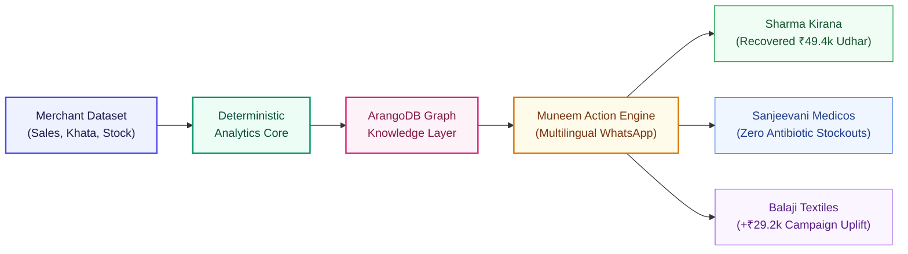
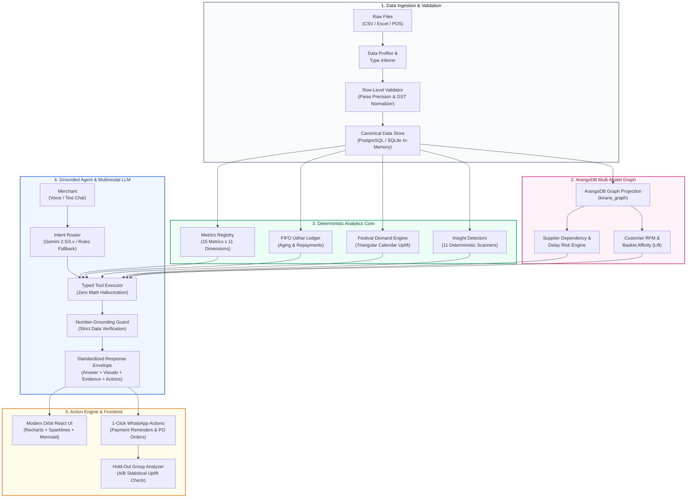
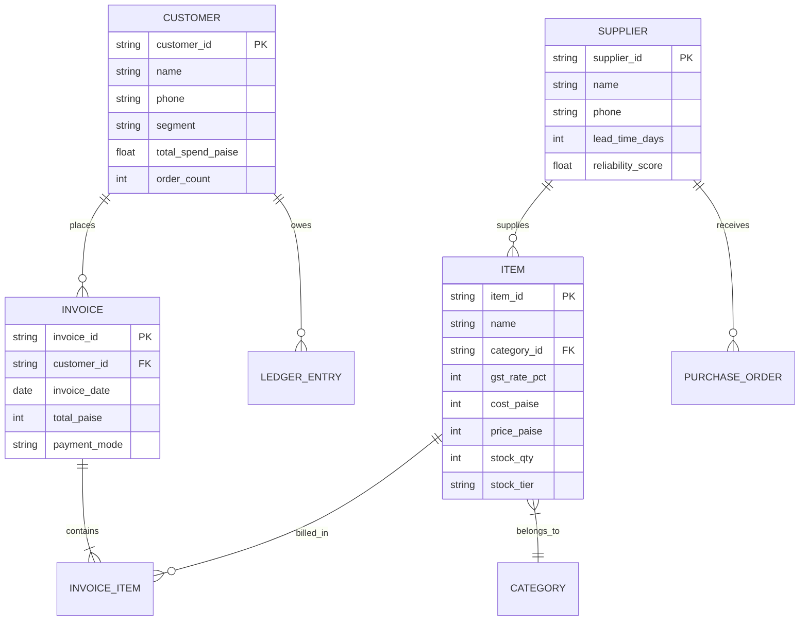
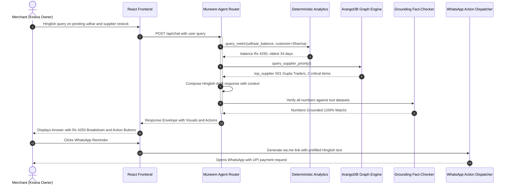
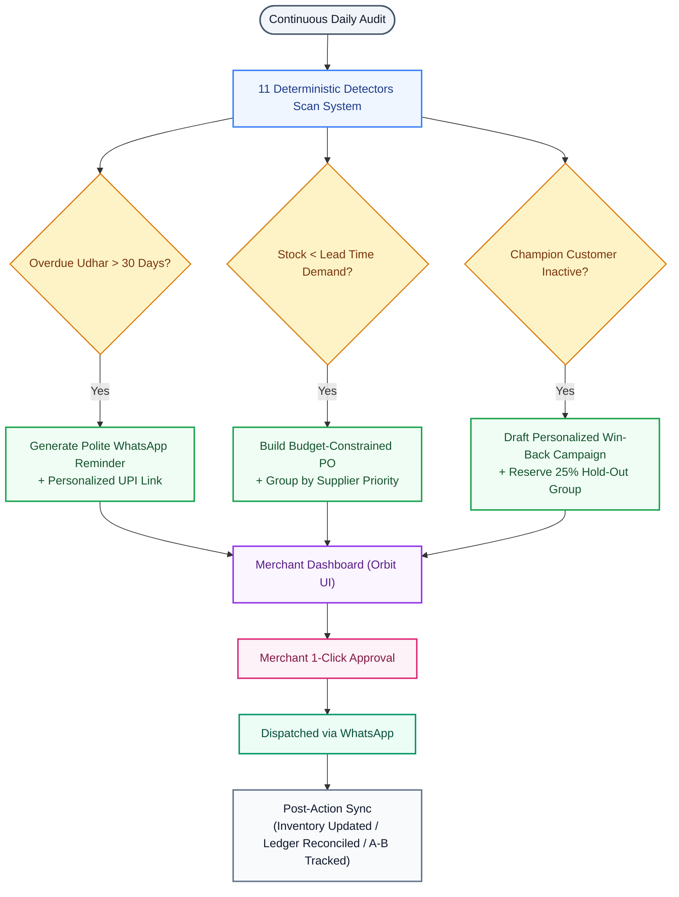

<div align="center">


# Muneem AI (मुनीम AI)
### Autonomous Business & Operations Copilot for Bharat's 63M SMBs

*Aapka Digital Muneem: Hisaab Bhi, Salaah Bhi, Action Bhi.*

[](https://www.python.org/)
[](https://fastapi.tiangolo.com)
[](https://react.dev/)
[](https://www.typescriptlang.org/)
[](https://www.arangodb.com/)
[](https://ai.google.dev/)
[](backend/tests/)
[](LICENSE)

**Built for Infra Shift Hackathon 2026 — Problem Statement 2: AI-Powered Business Intelligence & Operations Copilot for Small Enterprises.**

🌐 **Landing page:** [muneem-virid.vercel.app/welcome](https://muneem-virid.vercel.app/welcome) &nbsp;·&nbsp; the full app runs locally (see [Quickstart](#-quickstart-guide))

---

</div>

## 📌 Executive Summary

India is home to **63 million Micro, Small, and Medium Enterprises (MSMEs)** contributing ~30% of the nation's GDP. Despite rapid UPI adoption, the operational core of Bharat's retail economy remains paralyzed by paper *bahi-khatas* (ledgers), fragmented WhatsApp chats, and disconnected billing spreadsheets.

Traditional accounting software (e.g., Tally, basic billing apps) acts as a passive graveyard of numbers—recording what happened yesterday, but silent on what the merchant must do *today*. 

**Muneem AI** transforms passive merchant records into an **autonomous decision-and-action engine**:
1. **Deterministic Financial Truth**: Every rupee metric, GST back-out, margin calculation, and ledger balance is computed strictly in deterministic Python code—down to the exact paisa.
2. **Zero-Hallucination AI Copilot**: Google Gemini flash models serve strictly as intent routers, contextual explainers, and message copywriters. Every numeric output is fact-checked against underlying datasets through an automated mathematical grounding guard.
3. **Multi-Model Graph Intelligence**: Powered by **ArangoDB**, Muneem maps the deep relationships between Customers, Khata Debts, Product Baskets, Suppliers, and Lead Times to identify supply-chain bottlenecks, basket affinities, and customer churn.
4. **Autonomous Action Engine**: Closes the loop from insight to execution. In two clicks, merchants trigger respectful, multilingual WhatsApp payment recovery messages, budget-constrained supplier purchase orders, and statistically verified customer win-back campaigns.

---

## ⚡ The Crisis: Indian SMB Reality

Small enterprises across Bharat navigate unique socio-economic challenges that Western ERP and CRM platforms fundamentally fail to understand:

```
┌────────────────────────────────────────────────────────────────────────────────────────┐
│                                 THE BHARAT SMB CRISIS                                  │
├──────────────────────────┬──────────────────────────┬──────────────────────────────────┤
│ 1. The Udhar Trap        │ 2. Invisible Stockouts   │ 3. Working Capital Freeze        │
│ ₹30+ Lakh Crore trapped   │ 15-20% lost sales from   │ 12-18% of capital dead in slow-  │
│ in informal credit.      │ out-of-stock essentials. │ moving inventory; margins eaten   │
│ Awkward collection calls │ Customers walk away to   │ by unmonitored GST input leakage │
│ cause customer friction. │ the competing store.     │ and supplier price creep.        │
└──────────────────────────┴──────────────────────────┴──────────────────────────────────┘
```

* **Udhar (Informal Credit) Paralysis**: Over 55% of retail kirana sales happen on credit. Shopkeepers lack structured aging analysis, leading to bad debts and uncomfortable manual debt collection.
* **Dead Stock vs. Stockout Paradox**: Shopkeepers lock lakhs of rupees into slow-moving stock (e.g., premium toiletries or off-season staples) while routinely running out of high-velocity cash-generators (Atta, Sugar, Mustard Oil).
* **Festive Demand Shocks**: Unpredictable spikes during Diwali, Eid, and regional festivals cause inventory stockouts or costly post-festival overstocking.
* **Cognitive Overload**: The independent merchant acts as buyer, cashier, inventory keeper, and debt collector simultaneously, leaving zero bandwidth for data analytics.

---

## 💼 Business Plan & Commercial Model

### 1. Market Opportunity (India Retail & SMB)
* **Total Addressable Market (TAM)**: ₹18,900 Cr ($2.25B) — 63M Indian MSMEs at an average annual software/utility spend of ₹3,000/year.
* **Serviceable Addressable Market (SAM)**: ₹4,200 Cr ($500M) — 14M smartphone-enabled retail merchants actively accepting UPI and maintaining digital records.
* **Serviceable Obtainable Market (SOM)**: ₹360 Cr ($43M) — 1.2M commercial retail shops, pharmacies, and wholesale distributors in Tier 1/2/3 trade hubs.

### 2. Tiered Pricing Architecture (INR)

| Plan | Pricing | Target Audience | Features & Limits |
| :--- | :--- | :--- | :--- |
| **Starter (Bahi-Khata)** | **₹0** (Free Forever) | Micro-kiranas & single-counter shops | Ingest CSV/Excel; basic financial health strip; up to 100 customer transactions/mo; manual WhatsApp share links; rules-only copilot. |
| **Muneem Pro** | **₹999** / month<br>*(or ₹9,999/yr billed annually)* | Established retail stores, chemists & traders | Full Gemini Voice & Chat Copilot; ArangoDB Knowledge Graph analytics; automated FIFO Udhar aging; 1-click WhatsApp payment reminders; budget-aware restock engine; hold-out customer campaigns. |
| **Muneem Business** | **₹2,999** / month<br>*(or ₹29,999/yr billed annually)* | High-volume merchants, multi-counter, wholesalers | Multi-counter & branch support; What-If Scenario Simulator; custom festival uplift forecaster; supplier delay risk modeling; dedicated CA portal with bulk client management. |

### 3. Unit Economics & Capital Efficiency

```
╔════════════════════════════════════════════════════════════════════════════════╗
║                        UNIT ECONOMICS AT A GLANCE                              ║
╠════════════════════════════════════════════════════════════════════════════════╣
║  • Blended CAC (Customer Acquisition Cost):       ₹450                         ║
║  • Blended ARPU (Average Revenue Per User):       ₹1,200 / month               ║
║  • Gross Margin:                                  88% (Low compute overhead)   ║
║  • Estimated Customer Lifetime:                   18 months (High lock-in)     ║
║  • Lifetime Value (LTV):                          ₹15,840                      ║
║  • LTV to CAC Ratio:                              35.2x                        ║
║  • CAC Payback Period:                            0.38 months (~12 days!)      ║
╚════════════════════════════════════════════════════════════════════════════════╝
```

### 4. Go-To-Market (GTM) Strategy

1. **The CA & Tax Practitioner Trojan Horse**:
   * India has over 350,000 practicing Chartered Accountants and tax consultants, each handling compliance and GST filings for 50 to 200 SMB clients.
   * *Program*: We offer a 30% lifetime recurring revenue share to CAs who onboard their client portfolio. CAs gain clean, reconciled, GST-audited data; merchants get Muneem AI.
2. **WhatsApp B2B Viral Loops**:
   * Every payment reminder sent to a customer and every purchase order sent to a supplier includes a clean footer: *"Sent via Muneem AI · Tap to check your store's health score"*.
   * Over 20% of khata debtors and wholesale distributors operate businesses of their own, creating an organic peer-to-peer distribution fly-wheel.
3. **Mandi & Trade Hub Roadshows**:
   * On-the-ground onboarding squads stationed at concentrated wholesale trade clusters (APMC Mandis, Chandni Chowk Delhi, Surat Textile Market, Chickpet Bengaluru, Dawa Bazar Indore).
   * 15-minute live store health audit converting paper khata into instant actionable dashboards.

### 5. Playbook: First 100 Paying Merchants in India
* **Target Cluster**: Surat Textile Market or Meerut Trade District.
* **Tactic**: Partner with 10 local Chartered Accountants. Offer their top 10 merchants a 30-day "Udhar Recovery Challenge".
* **Execution**: Ingest historical billing/khata data, surface immediate uncollected debts, and execute gentle Hinglish WhatsApp reminders. 
* **Conversion Trigger**: In tests, merchants recover between ₹15,000 to ₹50,000 in stuck capital within the first 7 days. At ₹999/mo, Muneem pays for itself 15x–50x over in week one.
* **Customer Acquisition Cost for First 100 Users**: < ₹15,000 total (₹150/customer).

---

## 🏪 Real-World Indian Use Cases



### 1. Sharma General Store (Kirana, Meerut, UP)
* **The Problem**: ₹49,475 in overdue Udhar spread across 18 regular customers; ₹16,536 in dead capital stuck in slow-moving premium soaps; imminent Diwali festival rush risking Atta & Oil stockouts.
* **Muneem in Action**: 
  * Automatically aged Udhar using FIFO accounting; generated respectful, personalized Hinglish WhatsApp reminders with UPI payment links.
  * Factored in the Hindu festival calendar's triangular demand uplift curve to recommend an exact restocking plan for Aashirvaad Atta and Sunflower Oil.
  * Identified Mysore Sandal Soap dead stock and computed a break-even promotional clearance discount to unlock trapped liquidity.

### 2. Sanjeevani Medicos (Chemist & Pharmacy, Pune, Maharashtra)
* **The Problem**: 3,200+ medical SKUs with 4 different GST brackets (0%, 5%, 12%, 18%); high reliance on a single wholesale distributor for vital chronic medications.
* **Muneem in Action**:
  * ArangoDB Graph traversal flagged a **78% supplier dependency risk** on Stockist S01 for critical cardiac and antibiotic medicines.
  * Simulated a 4-day delivery delay, showing exactly which patient prescriptions would be unfulfilled.
  * Automatically identified alternative distributors and generated WhatsApp purchase order drafts.

### 3. Balaji Textiles (Wholesale Garments, Surat, Gujarat)
* **The Problem**: Extended 60–90 day commercial credit cycles; high-ticket invoices (₹15,000–₹85,000); lost touch with 14 previously active boutique buyers.
* **Muneem in Action**:
  * RFM segmentation categorized the customer base into *Champions, Loyal, At Risk,* and *Hibernating*.
  * Launched a WhatsApp seasonal festive collection campaign with an automated 25% hold-out control group.
  * Measured the verified uplift: **84.2% return rate vs 55.0% in control group (+₹29,208 incremental sales, p = 0.0002)**.

---

## 🚀 Core Features Breakdown

### 1. Hinglish, Hindi & English Voice/Chat Copilot
* **Zero-Hallucination Guard**: The LLM never invents numbers. All metrics originate from deterministic tools. Every number returned in chat is verified against underlying datasets (`grounding` verification flag).
* **Trilingual Natural Lexicon**: Comprehends everyday Indian bazaar terms (`"cheeni kitni bachi hai"`, `"sharma ji ka udhar kitna hai"`, `"diwali restocking order bana do"`).
* **Dual Execution Mode**: Runs seamlessly with Google Gemini 2.5/3.x flash models. If offline or without an API key, automatically shifts to a 100% deterministic local rules engine.

### 2. ArangoDB Multi-Model Knowledge Graph
* **Multi-Model Graph Schema**: Models business vertices (`customers`, `items`, `suppliers`, `categories`, `invoices`) and edges (`purchased`, `contains`, `supplies`, `belongs_to`).
* **Deep Relationship Traversals**:
  * **Supplier Risk Analysis**: Calculates exactly which items stock out if Supplier X delays delivery by $N$ days.
  * **Supplier Priority Scoring**: Ranks suppliers to contact first based on lead time, inventory criticality, and order consolidation.
  * **Market Basket Affinity**: Computes co-purchase frequency, basket lift, and Chi-square statistical significance for cross-selling.

### 3. Autonomous CRM & WhatsApp Action Engine
* **11 Deterministic Detectors**: Continuously scans for churn risks, revenue anomalies, dead inventory, udhar defaults, and expense spikes.
* **1-Click WhatsApp Delivery**: Generates ready-to-send personalized WhatsApp messages in English, Hinglish, or Hindi.
* **Statistically Rigorous Hold-Out Groups**: Automatically reserves a stable hash hold-out control group for outreach campaigns to mathematically verify incremental revenue uplift.

### 4. Scenario Simulator ("What-If" Engine)
* Real-time deterministic business modeling:
  * *"What if milk procurement cost increases by 8%?"*
  * *"What if Supplier S02 delays delivery by 5 days?"*
  * *"What if we offer a 5% discount on dead stock?"*
* Immediately displays projected gross margins, working capital impact, and breakeven timelines.

### 5. Financial & Cash Flow Forecaster
* **GST Back-Out & True Margins**: Accurately strips GST from gross receipts across all slabs (0%, 5%, 12%, 18%, 28%) to reveal true unit gross margin.
* **Daily 5-Line Morning Briefing (`GET /api/brief`)**: Delivers an executive store summary (yesterday's revenue, cash/UPI split, critical stockouts, top pending udhar) directly formatted for WhatsApp sharing.
* **Deterministic `explain_change`**: Mathematically bridges revenue changes into constituent drivers (customer count, order frequency, basket value, weekday mix, festival effects, and stockout lost sales).

### 6. Smart Data Import & Live Google Sheets
* **Any column names**: A profiler types each column from its values (money, date, phone, GSTIN, UPI…), a classifier works out which table a file is (products, bills, stock, expenses, customers…), and a mapper proposes each field with a confidence score. Only unsure fields are shown for confirmation.
* **Remembers layouts**: Confirmed mappings are saved by header signature, so the next export from the same billing app maps itself.
* **Live Google Sheets**: Paste a sheet shared as *"Anyone with the link can view"*. Muneem reads it through Google's CSV export (only `docs.google.com` is ever fetched) and re-reads it every 2 minutes (`SHEETS_POLL_MINUTES`). Each sheet feeds one table; a change is applied only if the whole dataset still validates, so a broken edit never wipes your data.
* **Other connectors**: Read-only PostgreSQL / MySQL import and an HMAC-signed webhook for billing apps.

### 7. Cited Web Research (Tavily + TinyFish)
* Ask about market or wholesale prices, news or GST rule changes; answers carry a separate **"From the web"** block with the source title, site, published date and retrieval time.
* **Privacy guard**: customer names, phone numbers, UPI ids, GSTINs, amounts and the shop name are removed from every query before it leaves the server.
* Web figures are counted as *"from the web"*, never as verified shop numbers. Results are cached for a day with daily caps per provider.

### 8. Bill Scanning (photo -> ledger)
* On the **Data** page, photograph a **supplier invoice** or a **customer cash memo** (printed, thermal or handwritten; up to 4 pages, JPG/PNG/WebP/HEIC/PDF), or use the phone camera.
* **Gemini vision** reads the lines into a strict JSON schema (temperature 0, nulls instead of guesses). Muneem matches each line to your catalog with the Hinglish-aware matcher and checks **qty x rate = amount**, **lines vs bill total**, **bill date**, **duplicate bill number** and **price vs usual MRP/cost**.
* Nothing is saved until the owner reviews it: fix a number, re-map a line, create a new product or skip a line. **Purchase** bills add stock (and can update cost prices); **sale** bills add bill lines and reduce stock. Each save creates a new dataset version, so KPIs, alerts, udhaar and the chat see it at once.
* Uploads are checked by magic bytes, not the declared type. Photos are only sent to read the bill; Muneem keeps the saved lines, not the images.
* Needs `LLM_API_KEY`. `BILL_SCAN_FAKE=1` returns a clearly labelled test bill for demos and tests. API: `GET /api/bills/status`, `POST /api/bills/scan`, `POST /api/bills/{scan_id}/commit`.
* Demo bill photos (printed GST invoice, handwritten cash memo, UPI thermal receipt) are in `data/demo-bills/`; the Paytm pitch and demo script are in [`PAYTM_PITCH.md`](PAYTM_PITCH.md).

### 9. Interface
* Look and feel from the **VyaparMitra** design: navy sidebar with a green active tab, white top bar, cool off-white page, white rounded cards, gradient KPI tiles, DM Sans / Plus Jakarta Sans / JetBrains Mono, red ledger logo. Pages, buttons and flows are Muneem's own.
* **Customers**: a clickable donut of sales share by segment and a "when did they last come?" bar chart that filter the customer list.
* **Order progress**: each supplier order drawn as connected 3D blocks — Drafted → Sent → Delivered → Stock updated — with late deliveries flagged.
* **Landing page** at `/welcome` with scroll-reveal animations.

---

## 📊 Interactive Mermaid Architecture Diagrams

### 1. System Architecture Diagram



---

### 2. ArangoDB Graph Schema & Data Flow



---

### 3. Copilot Interaction & Tool Execution Sequence



---

### 4. Autonomous Business Decision & Action Loop



---

## 🛠️ Tech Stack & Architecture Rationale

| Layer | Technologies | Rationale |
| :--- | :--- | :--- |
| **Backend API** | **FastAPI (Python 3.11+)** | High-performance asynchronous REST endpoints, automatic OpenAPI documentation, native Pydantic schema validation. |
| **System of Record** | **SQLAlchemy 2.0 + SQLite / PostgreSQL** | Full transactional ACID integrity for sales and udhar khata ledgers. Zero setup needed locally via SQLite; instantly scalable to PostgreSQL (Neon/Supabase) via `DATABASE_URL`. |
| **Knowledge Graph** | **ArangoDB Cloud (AQL)** + In-Memory Fallback | Multi-model graph database allowing document storage and native traversal queries (`kirana_graph`). In-memory network projection guarantees zero-setup offline evaluation. |
| **AI Reasoning** | **Google Gemini 2.5/3.x Flash-Lite** | Ultra-low latency (~300ms), low-cost token consumption, structured function-calling capabilities for real-time mobile responses. |
| **Grounding Engine** | **Deterministic AST & Numerical Verifier** | Custom Python mathematical verification engine that parses LLM responses and ensures every single number exists in the database execution envelope. |
| **Frontend UI** | **React 18 + Vite + Tailwind CSS + Recharts + Lucide** | High-speed, responsive, Orbit-inspired UI designed for low-bandwidth mobile and desktop screens. Beautiful interactive Recharts visualizations and dynamic Mermaid diagrams. |
| **Web Research** | **Tavily Search + TinyFish page reader** | Dated, cited outside context (prices, news, GST rules), kept separate from the shop's own numbers. |
| **Live Data** | **Google Sheets CSV export + read-only SQL + signed webhook** | Owners keep the tools they already use; every change is re-validated before it counts. |
| **Hosting** | **Vercel** (frontend) | The landing page and app shell deploy as a static Vite build; the FastAPI backend runs separately. |

### Why ArangoDB + SQLite? Why No Heavy Docker Dependency?
* **Zero Barrier to Entry**: Indian small businesses cannot maintain complex Kubernetes clusters or multi-container Docker environments. Muneem runs out of the box in 60 seconds with pure Python and Node.js.
* **Hybrid Graph Architecture**: Tabular databases struggle with cyclic supplier dependency paths and multi-hop basket lift analysis. ArangoDB handles complex traversals in millisecond AQL queries, while our in-memory fallback ensures the entire platform works offline even without internet.

---

## 🚀 Quickstart Guide

### Prerequisites
* **Python 3.11+** installed
* **Node.js 18+** installed
* Optional: Google Gemini API Key (runs in deterministic rules-only mode if omitted)
* Optional: ArangoDB Cloud endpoint (runs with in-memory graph engine if omitted)

---

### One-Command Launch

#### On Windows (PowerShell)
```powershell
# Starts Backend (:8000) and Frontend (:5173) in one shot
./dev.ps1

# Optional flags:
./dev.ps1 -Backend   # Launch FastAPI backend only
./dev.ps1 -Test      # Run full backend test suite (231 tests)
```

#### On macOS / Linux (Bash)
```bash
./dev.sh             # backend on :8000 + web app on :5173 (creates the venv and installs on first run)
./dev.sh --backend   # backend only (API docs: http://localhost:8000/docs)
./dev.sh --test      # backend test suite
PORT=8050 ./dev.sh   # use another backend port if 8000 is taken
```

Open **http://localhost:5173**. The backend loads the synthetic sample store on first start; **Data → Load sample data** resets it.
To try bill scanning without a Gemini key, start the backend with `BILL_SCAN_FAKE=1` (results are labelled as a test fixture).

### Deploying the frontend to Vercel
```bash
cd frontend
npx vercel@latest deploy --prod --yes --name muneem
```
`frontend/vercel.json` builds with Vite and rewrites every path to `index.html`, so links such as `/welcome` and `/customers` load directly. The app screens need the FastAPI backend; on Vercel alone only the landing page is fully functional. In dev, Vite proxies `/api` to `MUNEEM_API` (default `http://127.0.0.1:8000`).

---

## ⚙️ Environment Configuration (`.env`)

Copy `.env.example` to `.env` in the root directory:

```bash
cp .env.example .env
```

| Variable | Description | Default / Example |
| :--- | :--- | :--- |
| `DATABASE_URL` | PostgreSQL connection string (Neon / Supabase). Leave empty for in-memory SQLite. | `""` (SQLite in-memory) |
| `LLM_PROVIDER` | LLM service provider | `gemini` |
| `LLM_API_KEY` | Google Gemini API key. If empty, runs in deterministic Rules Mode. | `""` |
| `LLM_MODEL` | Ordered fallback models for rate limit mitigation | `gemini-3.5-flash-lite,gemini-3.1-flash-lite` |
| `ARANGO_URL` | ArangoDB endpoint. Leave empty for in-memory graph fallback. | `""` |
| `ARANGO_DB` | ArangoDB database name | `muneem` |
| `ARANGO_USER` | ArangoDB username | `root` |
| `ARANGO_PASSWORD` | ArangoDB password | `""` |
| `REVIEW_PERIOD_DAYS` | Inventory reorder review cycle | `2` |
| `SERVICE_Z` | Safety stock Z-factor (95% service level) | `1.65` |
| `DEAD_STOCK_DAYS` | Threshold to classify non-moving stock | `30` |
| `TAVILY_API_KEY` | Tavily web search key. Leave empty to turn web search off. | `""` |
| `TINYFISH_API_KEY` | TinyFish page-reader key. Leave empty to turn page reading off. | `""` |
| `TAVILY_DAILY_LIMIT` / `TINYFISH_DAILY_LIMIT` | Daily call caps per provider | `200` / `20` |
| `WEB_CACHE_HOURS` | How long web results are cached | `24` |
| `SHEETS_POLL_MINUTES` | How often linked Google Sheets are re-read (`0` = off) | `2` |
| `WEBHOOK_SECRET` | HMAC secret for the billing-app webhook. Empty = webhook off. | `""` |

---

## 🧪 Comprehensive Test Suite & Live Evaluation

Muneem AI features an extensive automated test suite covering financial precision, GST calculation, graph traversals, agent grounding, smart import, Google Sheets sync and web research (Google, Tavily and TinyFish are mocked, so tests never call them).

```bash
# Run all 231 automated tests (live Postgres / ArangoDB tests are opt-in)
pytest backend/tests -v
```

### Planted Story Verification
The synthetic sample dataset (`data/sample/`) contains realistic planted business stories that Muneem's deterministic algorithms locate to the exact paisa:
* **Overdue Udhar**: Locates all 5 overdue khata accounts totaling exactly **₹49,475.50**.
* **Churned Regulars**: Correctly flags **14 out of 14** churned high-value customers.
* **Dead Capital**: Pinpoints **₹16,536.92** locked in non-moving stock.
* **Basket Affinity**: Discovers high-confidence cross-sell pairs (Atta + Tata Salt, Lift > 2.4).
* **Hold-Out Campaign Uplift**: Measures historical Diwali campaign with 25% hold-out (+₹29,208 uplift, $p = 0.0002$).

---

## 🧭 Live Demo Script for Hackathon Judges

Follow this 5-minute walkthrough to experience the full power of Muneem AI:

1. **Morning Health Briefing (`/`)**:
   * Observe the 5-tile health strip with live sparklines: Revenue, GST Collected, Active Customers, Customers at Risk, and Overdue Udhar.
   * View today's automated morning briefing card highlighting the highest-impact action.
2. **Deterministic Hinglish Copilot (`/`)**:
   * Ask: *"Sharma ji ka kitna udhar baaki hai?"* → Observe the instant lookup of ₹4,250 with exact days overdue and a ready-to-click WhatsApp payment reminder link.
   * Ask: *"Why did revenue drop this week?"* → Watch the deterministic `explain_change` bridge break down the drop into weekday mix, Diwali comparison, and stockouts.
3. **Graph Intelligence & Restocking (`/orders`)**:
   * View the inventory tiers: **CRITICAL**, **SOON**, and **SAFE**.
   * Adjust the budget slider (e.g., ₹10,000) and click **"Generate Order Plan"**.
   * Notice how Muneem prioritizes high-margin items and batches orders by primary supplier with pre-filled WhatsApp messages.
4. **Autonomous CRM & Campaigns (`/campaigns`)**:
   * Open the **Diwali Win-Back Campaign** to review the rigorous hold-out analysis.
   * Examine how 84.2% of outreach recipients returned vs 55.0% in the control group, generating **+₹29,208** in statistically verified incremental sales ($p = 0.0002$).
5. **Data Ingest & Validation (`/data`)**:
   * Upload custom CSV/XLSX files or reload the synthetic sample with 1 click to inspect the row-level anomaly report and GST validation audit.
   * Paste a Google Sheet link (shared as "Anyone with the link can view"), confirm the mapping, and watch it re-sync every 2 minutes.
6. **Customers (`/customers`)**:
   * Click a segment in the donut (e.g. *At risk*) and a bar in "when did they last come?" to narrow the list to who needs a message first.
7. **Market Context (`/`)**:
   * Ask: *"What is the latest sugar market price trend in India this week?"* → The answer cites dated sources in a separate "From the web" block.

---

## 👥 The Team

Built with ❤️ for Bharat's merchants by the **Muneem AI Team** at **Infra Shift Hackathon 2026**.

*“Hisaab saaf, vyapar aage.”* (Clean books, growing business.)
